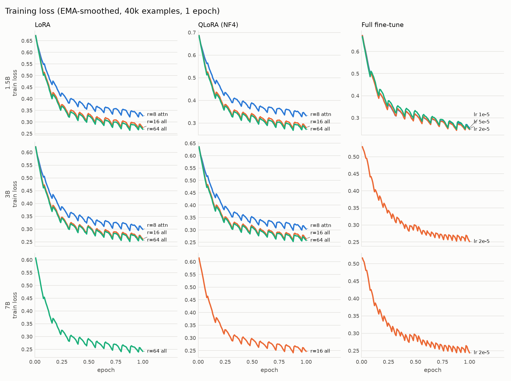
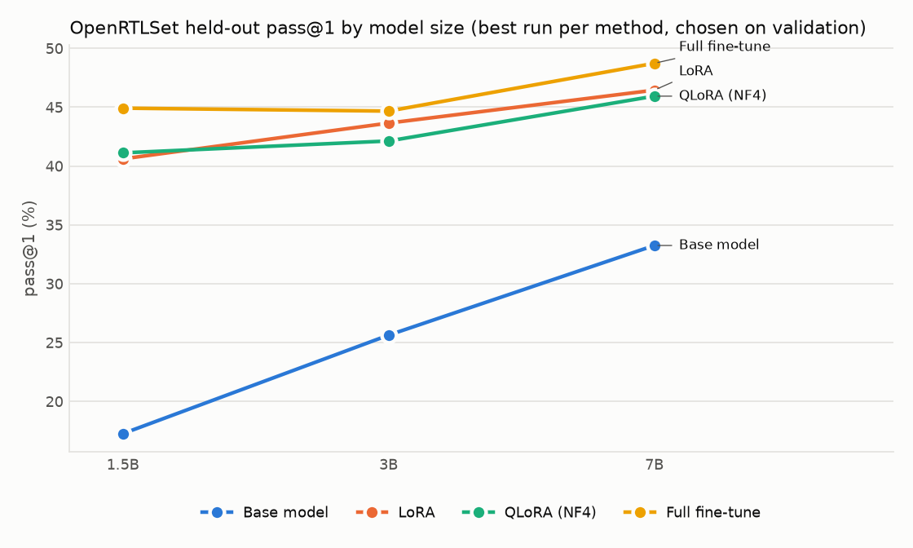

# verilog-coder-ft

Fine-tuned Qwen2.5-Coder models (1.5B / 3B / 7B) for Verilog and SystemVerilog generation,
scored by **functional correctness** (simulation), not text similarity. Includes a
LoRA vs QLoRA vs full fine-tuning comparison, a CLI, a Streamlit app, and local
serving on Apple Silicon (MLX), NVIDIA GPUs (vLLM), or anywhere else (Ollama).

**Headline results** (pass@1, greedy; best run per size chosen on a validation split):

| Model | OpenRTLSet held-out | VerilogEval v2 | VerilogEval v2 + interface |
|---|---|---|---|
| Qwen2.5-Coder-1.5B base | 17.3% | 10.3% | 19.2% |
| **1.5B fine-tuned** (full, lr 2e-5) | **44.9%** | **26.3%** | **27.6%** |
| Qwen2.5-Coder-3B base | 25.6% | 18.6% | 23.1% |
| **3B fine-tuned** (full, lr 2e-5) | **44.7%** | **26.9%** | **28.8%** |
| Qwen2.5-Coder-7B base | 33.2% | 31.4% | 38.5% |
| **7B fine-tuned** (LoRA r=64) | **46.5%** | 23.7% | 28.8% |
| Qwen2.5-Coder-14B base | 37.6% | 37.8% | 44.2% |
| CodeV-QW-7B (published) | 23.6% | 32.7% | 46.8% |
| RTLCoder-DeepSeek-6.7B (published) | 19.8% | 10.9% | 23.1% |

- Fine-tuning improves held-out OpenRTLSet modules at every size (p < 0.001); the
  fine-tuned 1.5B beats the 14B base model there.
- On VerilogEval it helps 1.5B and 3B but **hurts 7B** (31.4% → 23.7%, McNemar p = 0.05).
  Details and likely cause under [Results](#results).

Models: [1.5B](https://huggingface.co/henil08/verilog-coder-1.5b) ·
[3B](https://huggingface.co/henil08/verilog-coder-3b) ·
[7B](https://huggingface.co/henil08/verilog-coder-7b) ·
[7B LoRA adapter](https://huggingface.co/henil08/verilog-coder-7b-lora)

## What's in here

- **Data pipeline** for [OpenRTLSet](https://huggingface.co/datasets/ESCAD/OpenRTLSet):
  filtering, dedup, and a held-out test split of standalone, simulatable modules.
- **Training** with HF Transformers + PEFT + DeepSpeed ZeRO-2, run on Modal GPUs, logged to W&B.
- **Evaluation harness**: differential simulation against reference modules (Verilator)
  and VerilogEval v2 testbenches (Icarus Verilog), with per-example results in
  [results/](results/), confidence intervals, and paired significance tests.
- **Inference** behind one `generate(prompt) -> str` interface, auto-detecting MLX, vLLM,
  Ollama, or plain Transformers; 4-bit builds for MLX, vLLM (AWQ) and Ollama (GGUF).
- **Interfaces**: terminal CLI, Streamlit app, and a VS Code (Continue) setup.

## Use the model

```bash
uv sync --extra mlx --extra ui        # Apple Silicon
# uv sync --extra vllm --extra ui     # Linux / Windows WSL2 with an NVIDIA GPU

# Terminal
uv run python -m ui.cli "8-bit up counter with synchronous reset and enable" --model ft-7b --check
uv run python -m ui.cli --spec-file spec.txt --interface-file header.v --compare base-7b

# Browser: spec in, base vs fine-tuned side by side, Verilator compile check
uv run streamlit run ui/app.py
```

Model names (`ft-7b`, `base-3b`, ...) are defined in [configs/models.yaml](configs/models.yaml).
Fine-tuned builds are produced by `inference.convert` (below) or pulled from the Hub.
For VS Code, see [docs/vscode.md](docs/vscode.md).

| Platform | Backend | 4-bit build |
|---|---|---|
| macOS, Apple Silicon | MLX (`mlx-lm`) | MLX 4-bit |
| Linux, or Windows via WSL2, with an NVIDIA GPU | vLLM | AWQ (W4A16) |
| Native Windows, CPU-only, anything else | Ollama | GGUF Q4_K_M |
| Fallback | HF Transformers (CUDA / MPS / CPU) | – |

`load_backend("ft-7b")` picks the first one available, in that order:

```python
from inference import load_backend

backend = load_backend("ft-7b", quantized=True)
print(backend.generate("4:1 mux with a 2-bit select", interface="module mux4(...);"))
```

## Setup

```bash
uv sync                                 # core: data pipeline, eval harness
uv sync --extra train                   # training (DeepSpeed/bitsandbytes on Linux only)
uv sync --extra vllm                    # vLLM serving (Linux); kept apart from `train`
uv sync --extra mlx --extra ui          # Apple Silicon serving + Streamlit
```

Evaluation needs [Verilator](https://verilator.org) 5.x (diff-sim; the test set was
prepared with 5.052) and **Icarus Verilog v12** for VerilogEval, whose testbenches don't
compile under v13: `scripts/install_iverilog12.sh` builds v12 into `~/.local/opt` and
`IVERILOG_BIN_DIR` points the scorer at it. Scoring can also run on Modal
(`eval/modal_score.py`), which builds both tools in its image.

## Data

[OpenRTLSet](https://huggingface.co/datasets/ESCAD/OpenRTLSet) has 131k modules from
GitHub, each with an LLM-written description.

```bash
uv run python -m data.split     # data/processed/{train_*,val,test}.jsonl + stats.json
uv run python -m eval.prepare   # which test rows the harness can score
uv run python -m eval.prepare --split val
```

1. Drop the `lac-dcc/chimera` rows: 54.6k randomly generated fuzzer modules.
2. Dedupe on code with comments and whitespace removed.
3. Keep examples that fit in 2048 tokens once chat-formatted.
4. Label rows `verilog`, `systemverilog`, or `uvm` by the constructs they use.
5. Hold out 500 test rows stratified by label. Test rows must be standalone modules (no
   submodules, no `` `include ``) that pass `verilator --lint-only`.

| Stage | Rows |
|---|---|
| Raw | 131,309 |
| After dropping fuzzer rows | 76,668 |
| After dedup | 63,571 |
| After 2048-token cap | 54,732 |
| Test / validation | 500 / 500 |
| Train subsets | 20,000 (14.9M tokens) / 40,000 (29.9M tokens) |

**On UVM:** the raw corpus contains UVM testbench code in only 3 rows, and none survive
dedup and the length cap. The training data is ~93% Verilog and ~7% SystemVerilog. Nothing
in this project should be read as UVM capability.

**Prompt format.** The user turn is the description plus the module header as a code
block. Training only on that format made models drop the ports when the interface was
described in prose (see results), so the final runs describe the ports as a prose list in
~30% of training prompts (`interface_prose_fraction` in the config).

## Training

Runs live in [configs/experiments.yaml](configs/experiments.yaml): a 9-config method grid
crossed with model size, all at 1 epoch, effective batch 64, max length 2048, cosine
schedule, 3% warmup, bf16, length-grouped batches, loss on the code tokens only.

| Config | Method | Adapter | LR |
|---|---|---|---|
| L1 / Q1 | LoRA / QLoRA (NF4) | r=8, attention projections | 2e-4 |
| L2 / Q2 | LoRA / QLoRA (NF4) | r=16, all linear layers | 2e-4 |
| L3 / Q3 | LoRA / QLoRA (NF4) | r=64, all linear layers | 1e-4 |
| F1 / F2 / F3 | Full fine-tune | – | 1e-5 / 2e-5 / 5e-5 |

- **1.5B**: all 9 configs on 40k examples.
- **3B**: the 6 LoRA/QLoRA configs, plus one full fine-tune at the learning rate that won
  at 1.5B (chosen on validation).
- **7B**: the best LoRA and best QLoRA config from 3B, plus one full fine-tune, again
  chosen on validation.
- An earlier ablation of all 9 configs on 1.5B with 20k examples and code-block-only
  prompts is kept in [results/ablation_1p5b.md](results/ablation_1p5b.md).

Full fine-tunes shard optimizer state with DeepSpeed ZeRO-2 (3B on 2×H100, 7B on 2×H200);
the GPU count comes from the launcher, not the code.

```bash
# local smoke test of the training loop (CPU/MPS, 0.5B model)
uv run --extra train python -m training.train --experiment smoke --no-wandb --max-steps 4

# Modal: needs `modal token new` and `wandb-secret` / `huggingface-secret` secrets
uv run modal deploy eval/modal_generate.py      # once: generation app the trainer hands off to
uv run modal run --detach training/modal_app.py::main --runs grid:3B --evaluate --budget 28
uv run python -m training.collect --runs grid:3B

# any CUDA machine
torchrun --nproc_per_node 2 -m training.train --experiment 3B-F2
```

`--budget` reads the workspace's metered spend and refuses launches whose estimated cost
would exceed it. Each run writes `summary.json`: tokens/s, peak GPU memory, trainable
parameters, artifact size, losses, and cost.

<picture>
  <source media="(prefers-color-scheme: dark)" srcset="results/figures/training_loss_dark.png">
  
</picture>

The periodic bumps come from length-grouped batching (batches of similar-length
examples). Cost, memory, and throughput per run: [results/training_efficiency.md](results/training_efficiency.md).
The final 19 runs cost $57.91 of Modal compute.

## Evaluation

Every model gets the same prompts and greedy decoding, so pass@1 is deterministic.

- **OpenRTLSet held-out (diff-sim).** For each test module, the generated code must
  (a) lint cleanly in Verilator, (b) have exactly the reference's ports, and (c) produce
  outputs identical to the reference on every half-cycle of 500 cycles of random stimulus,
  with both designs in one generated testbench ([eval/diffsim.py](eval/diffsim.py)).
  Clocks and resets are found from port names; registers start at 0 in both designs.
- **Test-set eligibility.** A test row counts only if its reference passes against
  itself and *fails* against a stub that ties every output to 0, which proves the random
  stimulus can tell right from wrong. 394 of 500 test rows (and 248 of 500 validation rows)
  qualify.
- **VerilogEval v2 spec-to-RTL** (156 problems): the official testbenches and pass rule
  under Icarus v12, run twice: with the published prompts, and with the reference's
  interface also given as a code block (`verilog_eval_iface`). Four problems fail even
  with their own reference and are reported as such; 22 problems whose reference closely
  resembles a training row are flagged, and a "clean" subset excludes them
  ([eval/contamination.py](eval/contamination.py)).
- **Model selection on validation.** The best run per size and per method is chosen by
  diff-sim pass@1 on the validation split ([eval/select.py](eval/select.py)), never on test.
- **Statistics.** 95% Wilson intervals, and an exact McNemar test against the base model
  on the same items ([eval/report.py](eval/report.py)).
- **Per-example results** for every model are in `results/<model>.jsonl`: status,
  first mismatch, simulator log, and the generated code.

```bash
uv run modal run eval/modal_generate.py --models 7B-L3,base:7B   # vLLM on Modal
uv run python -m eval.score outputs/generations/*.jsonl          # or: modal run eval/modal_score.py
uv run python -m eval.select --sizes 1.5B,3B,7B
uv run python -m eval.report --baseline base-Qwen2.5-Coder-7B-Instruct --name summary
```

Caveats: random stimulus is evidence of equivalence, not proof; published checkpoints
(CodeV, RTLCoder) are run with this project's prompt through their own chat templates,
so their numbers are not comparable to their papers' prompts; each config is a single seed.

## Results

Full per-size tables with confidence intervals, compile rates, and McNemar tests:
[1.5B](results/grid_1.5B.md) · [3B](results/grid_3B.md) · [7B + references](results/grid_7B.md).

<picture>
  <source media="(prefers-color-scheme: dark)" srcset="results/figures/scaling_dark.png">
  
</picture>

**In-distribution gains are large and consistent.** Every one of the 19 fine-tunes beats
its base model on the 394 held-out OpenRTLSet modules (p < 0.001 for each). The best
fine-tuned 1.5B (44.9%) beats the 14B base (37.6%) on that set.

**Transfer to VerilogEval depends on size.** Fine-tuning lifts 1.5B from 10.3% to 26.3%
and 3B from 18.6% to 26.9%, but lowers 7B from 31.4% to 23.7–26.3% across all three
methods (best LoRA: 10 problems gained, 22 lost; of the 22, 13 are compile errors and 9
functional mismatches, and only 1 is a truncated output). The 7B base is already competent on
VerilogEval's textbook-style specs, and training on OpenRTLSet's real-world modules with
LLM-written descriptions pulls it toward that distribution. A model meant for both would
need VerilogEval-style data in the mix.

**Full fine-tuning vs LoRA vs QLoRA.**

OpenRTLSet held-out pass@1 for the run chosen on validation within each method:

| | 1.5B | 3B | 7B |
|---|---|---|---|
| Full fine-tune | 44.9% | 44.7% | 48.7% |
| LoRA | 40.6% (r=64) | 43.6% (r=64) | 46.5% (r=64) |
| QLoRA | 41.1% (r=64) | 42.1% (r=16) | 45.9% (r=16) |
| QLoRA vs LoRA peak GPU memory | 33.7 vs 35.6 GB | 35.0 vs 40.6 GB | 23.0 vs 34.7 GB |

- Full fine-tuning is best in-distribution at every size, by 1–4 points over the best LoRA.
  At 7B it needs two GPUs and produces a 15 GB artifact instead of a 0.3 GB adapter.
- QLoRA tracks LoRA's quality within about a point. Its memory saving is small at 1.5B
  (activations dominate) and real at 7B (−12 GB), for 5–20% lower throughput.
- Rank 8 on attention projections only is clearly worst; rank 16 and rank 64 on all
  linear layers are close.
- At 7B the validation pick was LoRA (113/248 vs 110 for full fine-tuning), even though
  full fine-tuning scores higher on test. Selection used validation only, by design.

**Prompt-format dependence.** In the first ablation (1.5B, 20k examples), every training
prompt gave the interface as a code block. VerilogEval describes ports in prose, and the
full fine-tunes scored 0/156 there because they wrote `module TopModule;` with no ports.
Describing ports in prose in ~30% of training prompts fixed it (LoRA r=64: 10.3% → 20.5%,
p < 0.001) without hurting OpenRTLSet; all final runs use that mix
([results/format_fix_1p5b.md](results/format_fix_1p5b.md)).

**Published fine-tunes.** CodeV-QW-7B is the strongest model here on VerilogEval with the
interface given (46.8%), but scores 23.6% on OpenRTLSet; RTLCoder trails the Qwen bases.
Both were run with this project's prompt, so their numbers understate what their own
prompts get.

**Repetition.** Greedy decoding loops on some long modules. Fine-tuned models hit the
2048-token cap on 9–15% of test outputs, versus 8.7% for the 1.5B base and 0.9% for the 7B
base; the training data has many near-identical declaration lines, and the models picked
up that habit.

## Inference builds and speed

```bash
uv run modal volume get verilog-ft-runs runs/7B-L3/model outputs/runs/7B-L3/model
uv run --extra train --extra mlx python -m inference.convert --run 7B-L3 --name ft-7b --all
uv run modal run inference/modal_awq.py::quantize --model henil08/verilog-coder-7b
uv run --extra mlx python -m inference.bench --model ft-7b --variants mlx,mlx-4bit,ollama
```

`inference.convert` merges the adapter, converts to MLX fp16 and 4-bit, builds a GGUF
(Q4_K_M) and registers it with Ollama. AWQ quantization (llm-compressor, calibrated on
validation examples) runs on a Modal GPU.

Single-stream decode speed, greedy, 10 VerilogEval prompts, 512 new tokens
([results/inference_bench.json](results/inference_bench.json)):

| Model | Apple M4 Pro 24 GB: MLX fp16 | MLX 4-bit | Ollama GGUF Q4_K_M | NVIDIA L40S: vLLM bf16 | vLLM AWQ 4-bit |
|---|---|---|---|---|---|
| 1.5B | 75.7 tok/s (3.3 GB) | 221.3 tok/s (1.2 GB) | 140.5 tok/s | – | – |
| 3B | 38.8 tok/s (6.3 GB) | 121.4 tok/s (2.1 GB) | 85.0 tok/s | – | – |
| 7B | 16.6 tok/s (15.4 GB) | 58.8 tok/s (4.6 GB) | 46.6 tok/s | 48.0 tok/s | 132.6 tok/s |

Peak memory in parentheses (MLX). 4-bit builds decode about 3× faster in a third of the
memory; their accuracy was not re-measured, and the eval numbers above are for the
full-precision models. The 3B and 7B Mac numbers were measured while a large upload was
running and may be slightly low.

Published builds: `henil08/verilog-coder-{1.5b,3b,7b}` (merged weights),
`-mlx-4bit`, `-gguf` (`ollama run hf.co/henil08/verilog-coder-7b-gguf`),
`henil08/verilog-coder-7b-awq`, and `henil08/verilog-coder-7b-lora` (adapter only).

## Repository layout

```
configs/     experiment grid, DeepSpeed configs, model registry
data/        OpenRTLSet loading, filtering, splits, shared prompt format
training/    training script, Modal launcher, cost estimates, collect
eval/        diff-sim + VerilogEval harness, scoring, selection, reports
inference/   backends (MLX, vLLM, Ollama, Transformers), conversion, AWQ, benchmarks, Hub push
ui/          CLI and Streamlit app
docs/        VS Code / Continue setup
results/     per-example results, summaries, figures
```
